# FitFlow

**Workouts that match your mood.** Answer six quick questions about how you feel, pick the trainers you like, and FitFlow builds a workout plan from curated YouTube videos: strength, cardio, stretching, yoga and calm sessions, with rest days built in. Every day it asks how you feel and adjusts today's workout.

**Live demo:** [fitflow-nk-lymenok.vercel.app](https://fitflow-nk-lymenok.vercel.app)

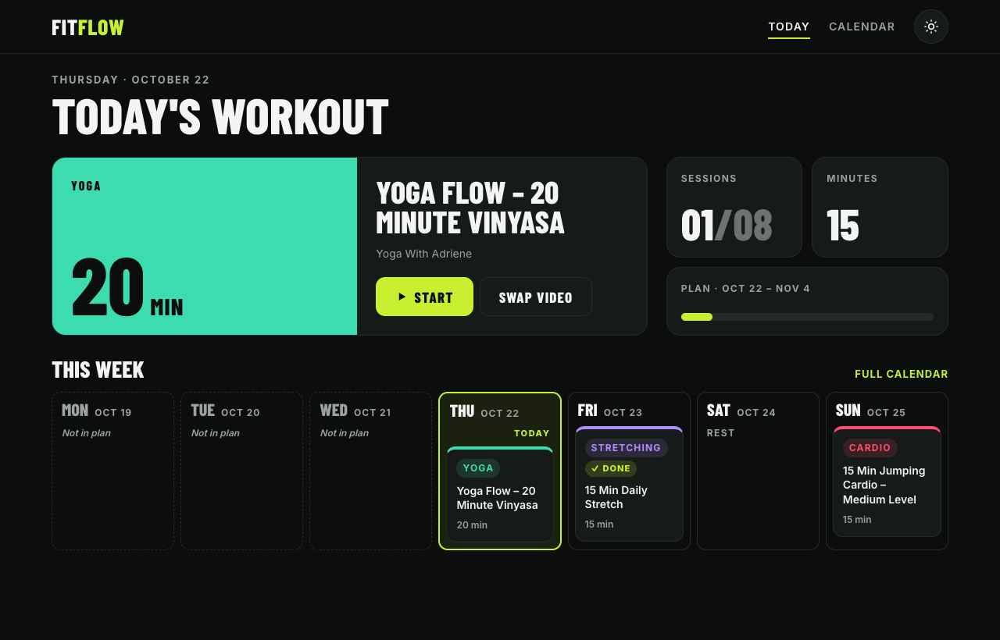

This is a portfolio project, built with an AI coding assistant (Claude Code) using **spec-driven development**: every feature started as a written spec, then a technical plan, then a task list, and only then code. The specs are in [`specs/`](specs/), and each commit names the task it implements.

## What it does

- **Mood quiz.** Six one-tap questions: mood, energy, goal, days per week, minutes per session, plan length. Each answer explains what it means.
- **Trainers.** Nine YouTube trainers, English and Ukrainian, with what they teach, how many videos and how long. Choose one to five of them (or any), and switch off workout types you don't want, in the quiz or later; changing your mind rebuilds the plan from today and keeps what you've done. FitFlow warns you when a choice can't fill your session length.
- **Generated plan.** Sessions are spread over the chosen days and filled with videos that add up to the chosen length. The mix of workout types follows the answers: a stressed, low-energy user gets mostly calm, yoga and stretching sessions, and a motivated, high-energy user gets mostly strength and cardio.
- **Today.** The home screen shows today's workout with one-tap Start, or tells you it's a rest day and what's next.
- **Daily check-in.** One tap: Low, Okay or Ready. Feeling low on a cardio day? FitFlow offers something gentler of the same length; ready on a rest day, a short extra session. Swap in two taps, undo any time that day.
- **Progress.** A streak of training days, this week's sessions and minutes, and how you felt each day marked in the calendar.
- **Add to calendar.** Download the plan as an `.ics` file for Google Calendar, Apple Calendar or Outlook.
- **Calendar.** Week and month views, today highlighted, finished sessions marked.
- **Workout page.** Videos play in an embedded YouTube player; the next video starts when one ends. Mark a session done or skipped.
- **Editing.** Swap any video for a similar one, change a session's type, move it to another day (moving onto a busy day swaps the two), delete it, or add a session on a rest day.
- **Two themes.** A dark, sporty "Night Training" theme and a light "Soft Glow" theme. The first visit follows the device setting; the switch is remembered.
- **Made for phones too.** A bottom tab bar on small screens; motion turns off when the system asks for reduced motion.
- **No sign-up.** Everything is saved in the browser and survives reloads.

| Light theme | Quiz | Phone |
|---|---|---|
| 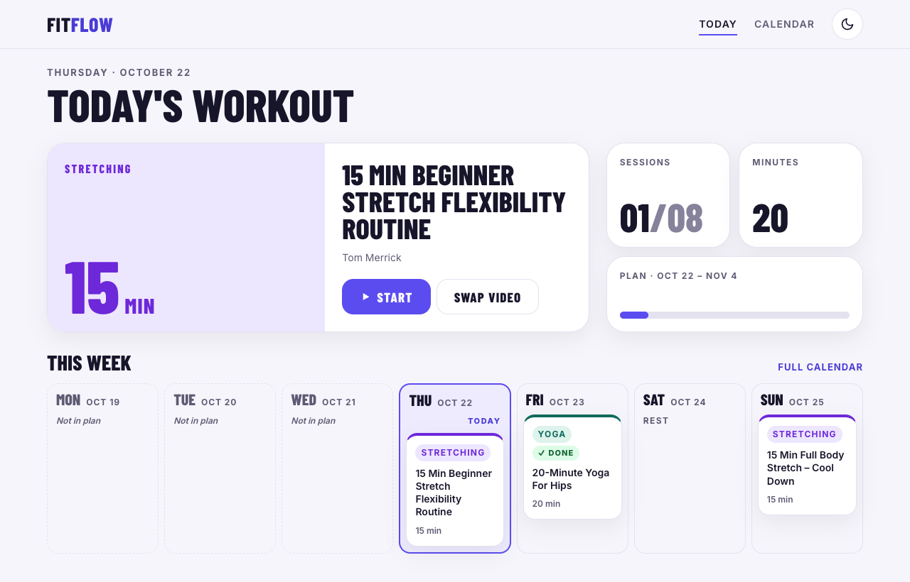 | 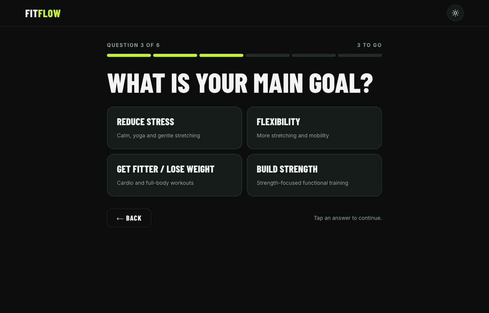 | 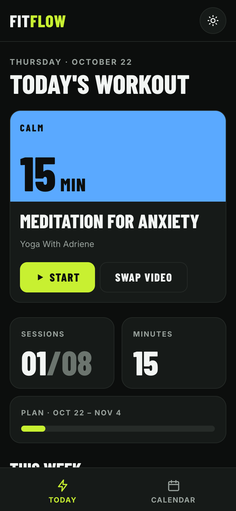 |

| Trainers | A trainer's videos | Choosing trainers in the quiz |
|---|---|---|
| 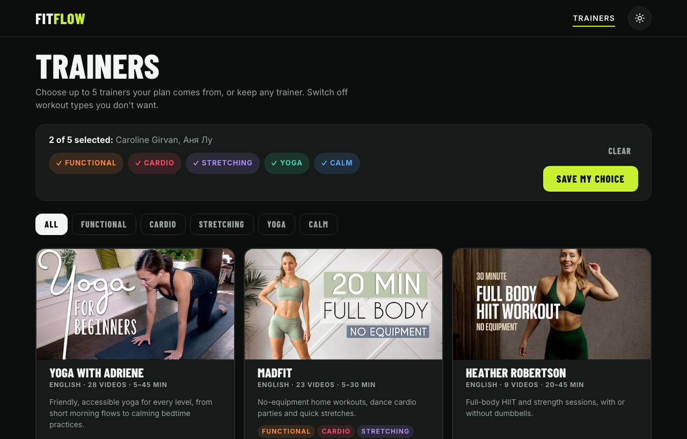 | 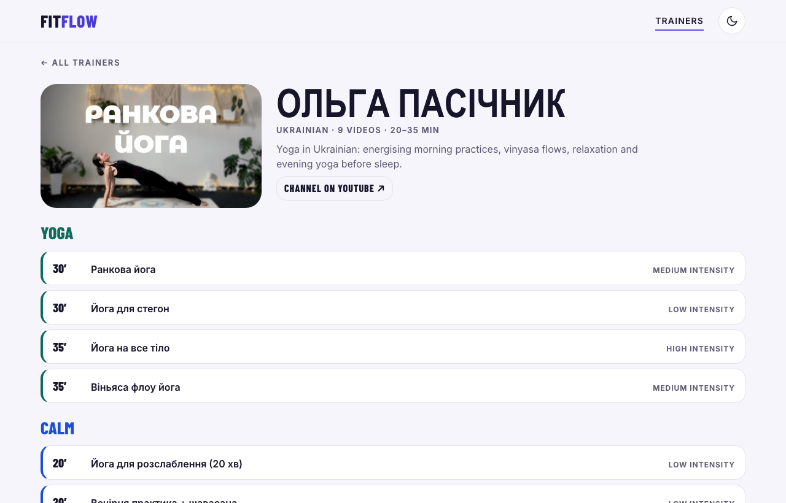 | 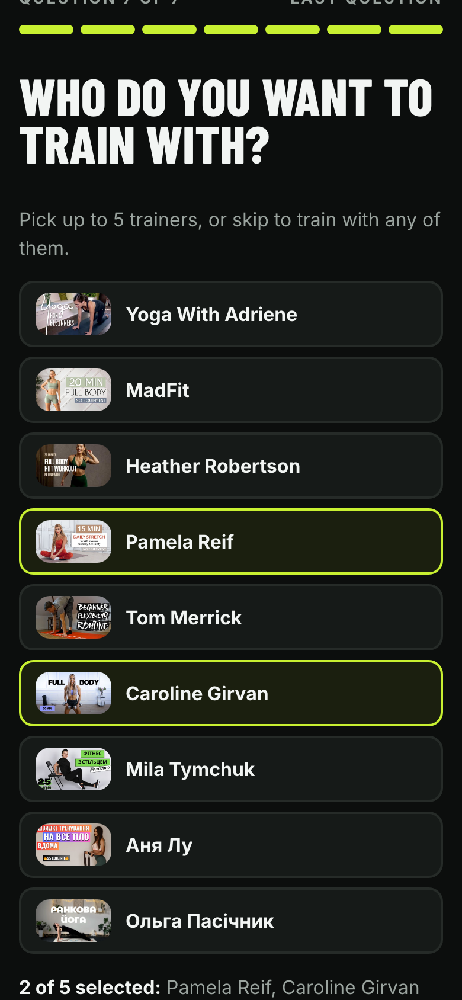 |

| Daily check-in | After a swap |
|---|---|
| 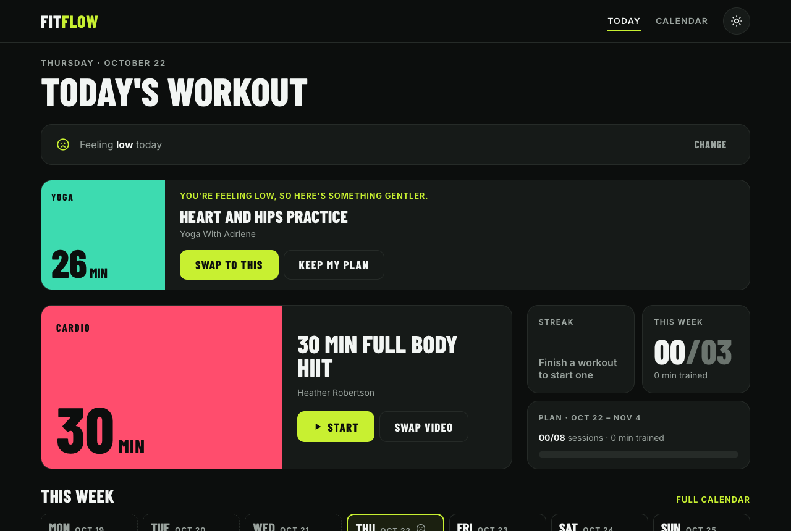 | 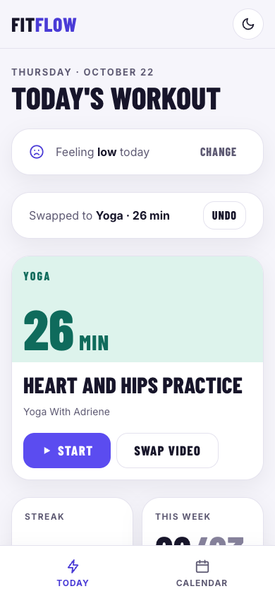 |

| Week | Month | Workout |
|---|---|---|
| 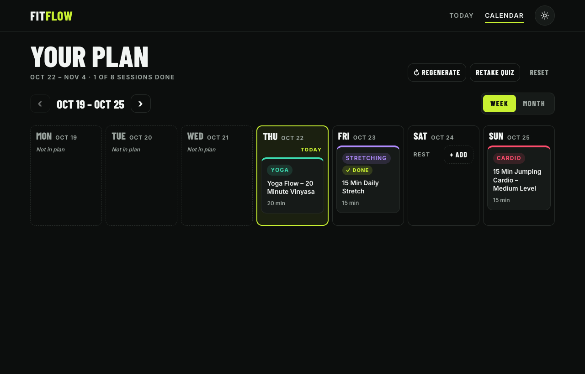 | 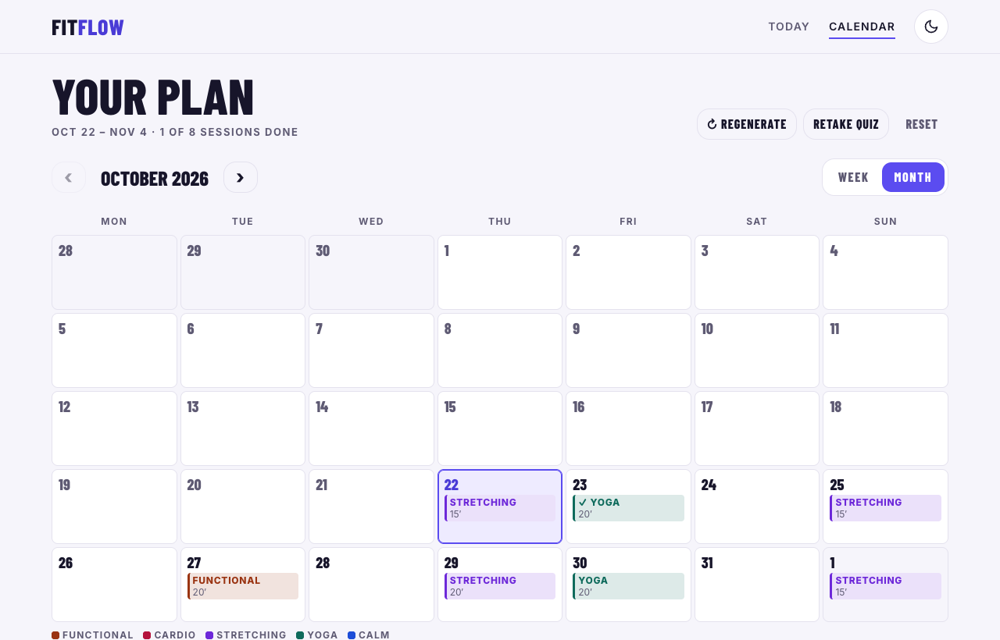 | 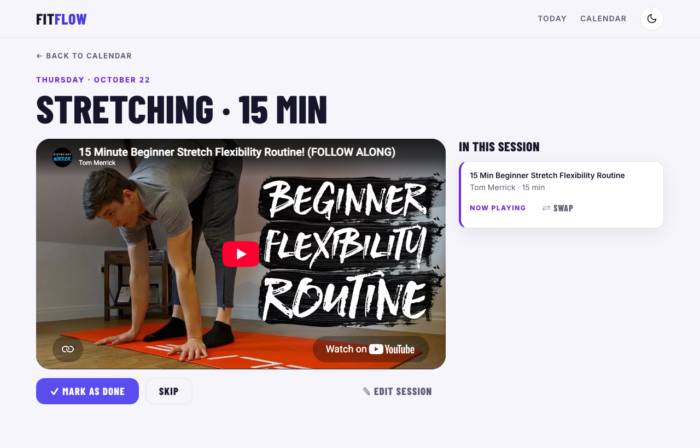 |

## How it was built

### Spec-driven development with AI

Four features so far, each with the same four documents, under one shared [constitution](specs/constitution.md) (stack, no backend, no API keys, testing, quality bar):

| Step | [001 · Workout planner](specs/001-workout-planner/) | [002 · UI refresh](specs/002-ui-refresh/) | [003 · Mood and progress](specs/003-mood-and-progress/) | [004 · Trainers](specs/004-trainers/) |
|---|---|---|---|---|
| Spec: user stories, acceptance criteria, out of scope | [spec.md](specs/001-workout-planner/spec.md) | [spec.md](specs/002-ui-refresh/spec.md) | [spec.md](specs/003-mood-and-progress/spec.md) | [spec.md](specs/004-trainers/spec.md) |
| Plan: architecture, data, trade-offs, risks | [plan.md](specs/001-workout-planner/plan.md) | [plan.md](specs/002-ui-refresh/plan.md) | [plan.md](specs/003-mood-and-progress/plan.md) | [plan.md](specs/004-trainers/plan.md) |
| Tasks: ordered, each with a "done when" check | [tasks.md](specs/001-workout-planner/tasks.md) (26) | [tasks.md](specs/002-ui-refresh/tasks.md) (17) | [tasks.md](specs/003-mood-and-progress/tasks.md) (13) | [tasks.md](specs/004-trainers/tasks.md) (15) |
| Acceptance: every criterion checked | [acceptance.md](specs/001-workout-planner/acceptance.md) | [acceptance.md](specs/002-ui-refresh/acceptance.md) | [acceptance.md](specs/003-mood-and-progress/acceptance.md) | [acceptance.md](specs/004-trainers/acceptance.md) |

I made the product decisions: the idea, the trainers (the AI researched Ukrainian channels, and I approved them; see the [catalog review](specs/004-trainers/catalog-review.md)), the quiz, the scope of each release, the visual direction (picked from four mockups) and when to move on. The AI drafted the documents, mockups and code, and I reviewed them at checkpoints. When implementation showed the plan was wrong (for example, no high-intensity yoga video was short enough for a 10-minute session), the plan was updated first and the code second. The git history shows this: one commit per task.

Spec 002 started with a safety net: before any visual change, all of 001's acceptance checks became automated end-to-end tests, so the redesign could not quietly break a feature. Spec 003 changed the saved-data format for the first time: a `migrate()` hook planned back in 001 upgrades existing users' plans, tested against real data saved by the previous release. Spec 004 changed it again (version 3) and went through two review checkpoints: the first swapped two Ukrainian channels that had too few videos with a known length, and the second moved a button, made saving visibly confirm what happened to the plan, and added trainer pictures.

### Architecture

```
src/
  domain/      pure JavaScript, no React: quiz, weights, plan generation,
               video picking, edits (reducer), today, check-in suggestions,
               streaks, .ics export, storage with migrations, dates — all unit-tested
  data/        trainers.json (9 trainers) and catalog.json (125 curated videos)
  state/       plan and theme providers; the plan is saved to localStorage on every change
  styles/      design tokens: one set of names, two themes (dark, light)
  pages/       Landing, Quiz, Today, Calendar, Session, Trainers, Trainer
  components/  week/month views, player, tab bar, dialogs, editors
e2e/           Playwright tests: user flows, accessibility, keyboard, themes, motion
```

All decisions live in `src/domain/`; React components only render state and dispatch actions. That keeps the logic easy to test and the UI thin.

**Theming.** Every color, radius and shadow is a semantic token (`--surface`, `--accent`, `--cat-yoga`…) defined once per theme under `:root[data-theme]`, so components carry no theme logic. A tiny inline script in `index.html` sets the theme before any CSS loads, so the page never flashes the wrong theme.

**Plan generation** is a pure function of the quiz answers, the catalog and a random seed, so the same inputs always give the same plan:

1. Each answer adds points to the five workout types (a lookup table); every type keeps a minimum weight so plans stay varied. Types the chosen trainers don't teach, that are switched off, or that have no video short enough for the session length get no weight.
2. Training days follow a fixed spread for the chosen days per week, starting today.
3. Each session gets a weighted-random type, never the same type more than twice in a row.
4. Videos are picked to land within ±5 minutes or ±25% of the target length: one video if possible, otherwise two or three combined. Videos used in the previous 7 days are avoided, and the energy-based intensity filter is relaxed only when nothing else fits.

### Quality

- **191 unit tests** (Vitest). One test generates a plan for every possible set of quiz answers (2,880 combinations) with 3 seeds and checks every rule from the spec: session days, length tolerance, no avoidable video repeats, valid catalog IDs. Another generates plans with every trainer alone and checks that only their videos are used.
- **End-to-end tests** (Playwright) for every acceptance criterion, in Chromium, Firefox and WebKit, at desktop and phone sizes: 414 runs. They also run against the live site after each deploy.
- **Accessibility:** axe-core reports no violations on any page or dialog in either theme; contrast meets WCAG AA; the whole flow is tested with the keyboard alone; dialogs use the native `<dialog>` element for focus handling; all motion respects "reduce motion".
- **Responsive** from 360px phones to desktop, with no sideways scrolling.
- **Catalog check:** `npm run check:catalog` confirms through YouTube's public oEmbed endpoint (no API key) that every video still exists, allows embedding and belongs to the expected trainer's channel.
- **Fast:** self-hosted fonts, and the YouTube player script loads only when a workout is opened.

## Tech stack

React 19 · Vite · React Router · date-fns · CSS Modules · Vitest · Playwright · axe-core · ESLint · Vercel

No backend, no accounts and no API keys: the app is static, and user data stays in the browser.

## Run it locally

Requires Node.js 22 or newer.

```bash
cd fitflow
npm install
npm run dev              # start the dev server
npm test                 # unit tests
npx playwright install   # once: browsers for the e2e tests
npm run test:e2e         # end-to-end tests (builds and serves the app)
npm run lint             # ESLint
npm run build            # production build
npm run check:catalog    # check every catalog video on YouTube
npm run sample:plans     # print a few generated plans
```

## What's next

Ideas for later specs: more trainers (about 20, with short videos from Mila Tymchuk and Ольга Пасічник so they can fill 10-minute sessions alone), reminders, a history of moods and workouts across plans, and sharing a plan with a friend.

## Credits

Workout videos by [Yoga With Adriene](https://www.youtube.com/@yogawithadriene), [MadFit](https://www.youtube.com/@MadFit), [Heather Robertson](https://www.youtube.com/@Heatherrobertsoncom), [Pamela Reif](https://www.youtube.com/@PamelaRf1), [Tom Merrick](https://www.youtube.com/@BodyweightWarrior), [Caroline Girvan](https://www.youtube.com/@CarolineGirvan), [Mila Tymchuk](https://www.youtube.com/@milatymchuk), [Аня Лу](https://www.youtube.com/@anialu) and [Ольга Пасічник](https://www.youtube.com/@pasichnyk_olha). All videos and thumbnails belong to their creators; videos play through YouTube's embedded player and thumbnails load from YouTube. FitFlow is not affiliated with any of them.
