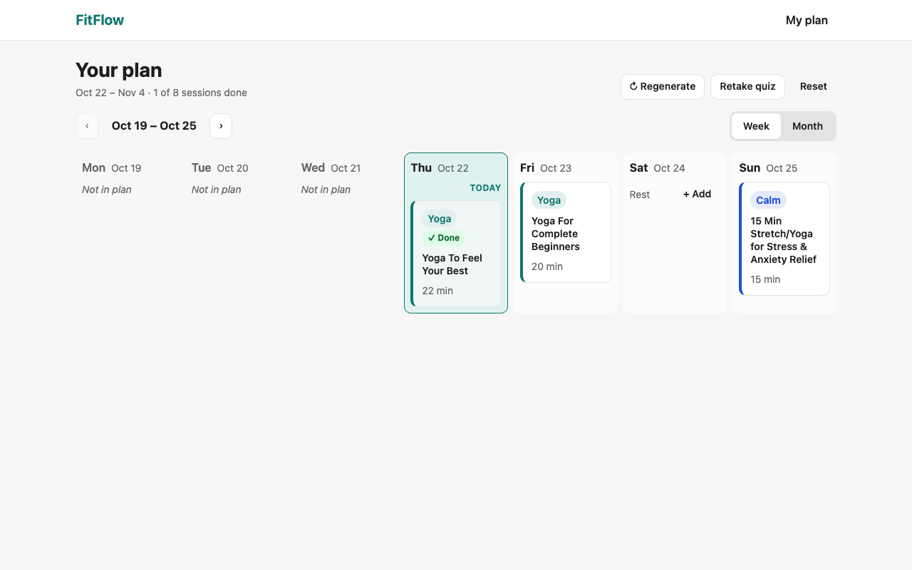
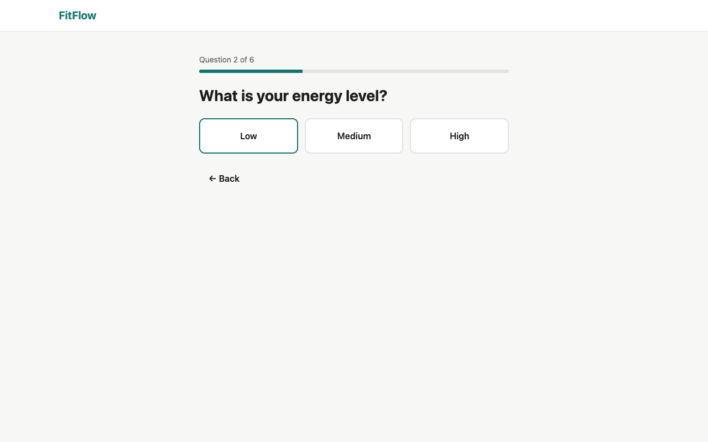
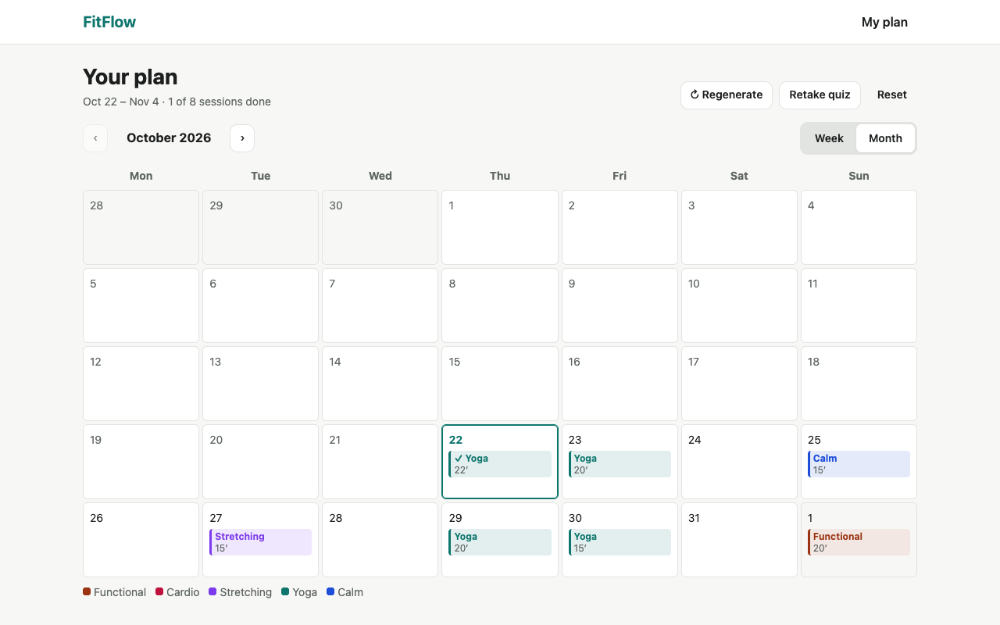
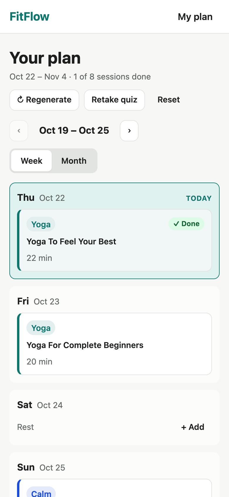
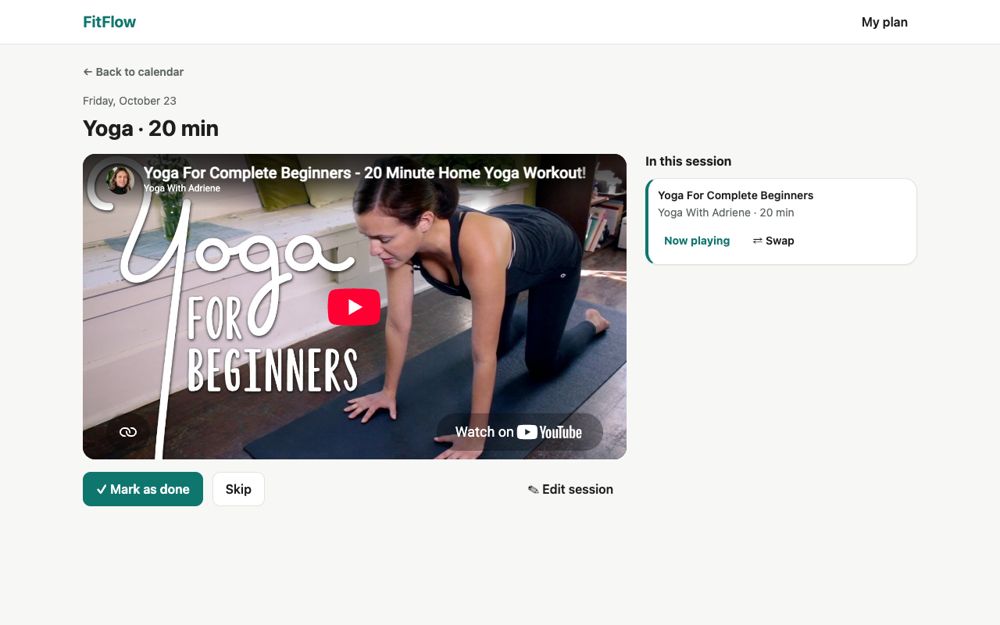

# FitFlow

**Workouts that match your mood.** Answer six quick questions about how you feel, and FitFlow builds a workout calendar from curated YouTube videos: strength, cardio, stretching, yoga and calm sessions, with rest days built in.

**Live demo:** [fitflow-nk-lymenok.vercel.app](https://fitflow-nk-lymenok.vercel.app)



This is a portfolio project, built with an AI coding assistant (Claude Code) using **spec-driven development**: every feature started as a written spec, then a technical plan, then a task list, and only then code. The specs are in [`specs/`](specs/), and each commit names the task it implements.

## What it does

- **Mood quiz.** Six one-tap questions: mood, energy, goal, days per week, minutes per session, plan length.
- **Generated plan.** Sessions are spread over the chosen days and filled with videos that add up to the chosen length. The mix of workout types follows the answers: a stressed, low-energy user gets mostly calm, yoga and stretching sessions, and a motivated, high-energy user gets mostly strength and cardio.
- **Calendar.** Week and month views, today highlighted, progress at a glance.
- **Workout page.** Videos play in an embedded YouTube player; the next video starts when one ends. Mark a session done or skipped.
- **Editing.** Swap any video for a similar one, change a session's type, move it to another day (moving onto a busy day swaps the two), delete it, or add a session on a rest day.
- **No sign-up.** Everything is saved in the browser and survives reloads.

| Quiz | Month view | Phone |
|---|---|---|
|  |  |  |



## How it was built

### Spec-driven development with AI

| Step | Document | What it holds |
|---|---|---|
| 0 | [Constitution](specs/constitution.md) | Project-wide rules: stack, no backend, no API keys, testing, quality bar |
| 1 | [Spec](specs/001-workout-planner/spec.md) | User stories with acceptance criteria, requirements, out of scope |
| 2 | [Plan](specs/001-workout-planner/plan.md) | Architecture, data model, generation algorithm, risks |
| 3 | [Tasks](specs/001-workout-planner/tasks.md) | 26 ordered tasks, each with a "done when" check |
| 4 | [Acceptance](specs/001-workout-planner/acceptance.md) | Every acceptance criterion checked against the running app |

I made the product decisions: the idea, the five YouTube channels, the quiz, the scope of the first release and when to move on. The AI drafted the documents and the code, and I reviewed them at checkpoints after the domain logic and after the UI. When implementation showed the plan was wrong (for example, no high-intensity yoga video was short enough for a 10-minute session), the plan was updated first and the code second. The git history shows this: one commit per task.

### Architecture

```
src/
  domain/      pure JavaScript, no React: quiz, weights, plan generation,
               video picking, edits (reducer), storage, dates — all unit-tested
  data/        catalog.json: 76 curated videos from 5 channels
  state/       React context + useReducer, saved to localStorage on every change
  pages/       Landing, Quiz, Calendar, Session
  components/  week/month views, player, dialogs, editors
```

All decisions live in `src/domain/`; React components only render state and dispatch actions. That keeps the logic easy to test and the UI thin.

**Plan generation** is a pure function of the quiz answers, the catalog and a random seed, so the same inputs always give the same plan:

1. Each answer adds points to the five workout types (a lookup table); every type keeps a minimum weight so plans stay varied.
2. Training days follow a fixed spread for the chosen days per week, starting today.
3. Each session gets a weighted-random type, never the same type more than twice in a row.
4. Videos are picked to land within ±5 minutes or ±25% of the target length: one video if possible, otherwise two or three combined. Videos used in the previous 7 days are avoided, and the energy-based intensity filter is relaxed only when nothing else fits.

### Quality

- **94 unit tests** (Vitest). One test generates a plan for every possible set of quiz answers (2,880 combinations) with 3 seeds and checks every rule from the spec: session days, length tolerance, no avoidable video repeats, valid catalog IDs.
- **Accessibility:** axe-core reports no violations on any page or dialog; the whole flow works with the keyboard alone; dialogs use the native `<dialog>` element for focus handling.
- **Responsive** from 360px phones to desktop.
- **Catalog check:** `npm run check:catalog` confirms through YouTube's public oEmbed endpoint (no API key) that every video still exists, allows embedding and belongs to the expected channel.
- The YouTube player script loads only when a workout is opened.

## Tech stack

React 19 · Vite · React Router · date-fns · CSS Modules · Vitest · ESLint · Vercel

No backend, no accounts and no API keys: the app is static, and user data stays in the browser.

## Run it locally

Requires Node.js 22 or newer.

```bash
cd fitflow
npm install
npm run dev              # start the dev server
npm test                 # unit tests
npm run lint             # ESLint
npm run build            # production build
npm run check:catalog    # check every catalog video on YouTube
npm run sample:plans     # print a few generated plans
```

## What's next

The first release covers the core flow. Planned for a follow-up spec:

- a daily mood check-in that suggests a lighter or harder session when today's mood doesn't fit the plan;
- simple progress stats: streak, sessions and minutes per week;
- calendar export (.ics) and a dark theme.

## Credits

Workout videos by [Yoga With Adriene](https://www.youtube.com/@yogawithadriene), [MadFit](https://www.youtube.com/@MadFit), [Heather Robertson](https://www.youtube.com/@HeatherRobertsoncom), [Pamela Reif](https://www.youtube.com/@PamelaRf1) and [Tom Merrick](https://www.youtube.com/@BodyweightWarrior). All videos belong to their creators and play through YouTube's embedded player. FitFlow is not affiliated with any of them.
